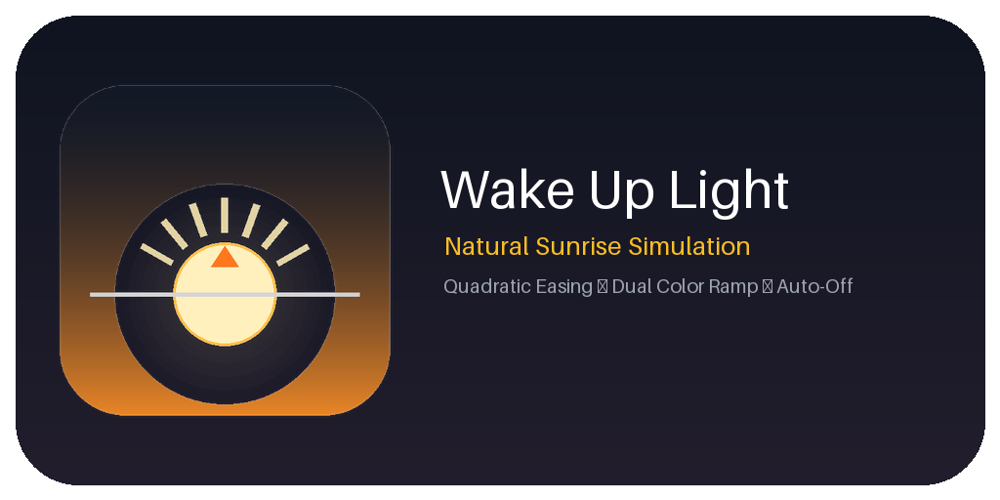

# Wake Up Light for Home Assistant

**A universal, hardware-agnostic sunrise simulator with quadratic perceptual easing, dynamic alarm detection, and multi-curve gradients.**

---

## Overview

Most standard wake-up light scripts suffer from a fundamental physical limitation: **human vision perceives light intensity logarithmically**, not linearly. A linear ramp from 0% to 10% brightness appears as an abrupt, jarring shock in a dark bedroom.

**Wake Up Light** solves this by implementing **quadratic perceptual easing** ($B = B_{start} + (B_{max} - B_{start}) \cdot t^2$) along with gentle color temperature and RGB interpolation. It turns any light (smart bulbs, ceiling fixtures, LED strips) into an ultra-natural dawn simulator.

---

## Key Highlights

- **Quadratic Perceptual Easing**: Starts near-imperceptibly in ultra-deep red/amber and gently accelerates towards dawn daylight.
- **Provider-Agnostic Alarm Detection**:
  - `input_datetime` helpers (e.g. shift-work or manual calendar-based helpers).
  - Next Alarm sensors (Android / iOS Home Assistant Companion App, Alexa, Google Assistant).
  - Fixed schedule with weekday selector.
- **Dynamic Duration Binding**: Set a static duration (e.g. 15 minutes) or dynamically bind to any `input_number` or `number` helper entity.
- **Universal Light Hardware Support**:
  - Automatically checks `supported_color_modes` of your target lights.
  - Native Kelvin color temperature (2000K amber dawn $\rightarrow$ 4800K crisp morning white).
  - RGB gamut approximation for bulbs without native color temperature support.
  - Brightness-only mode for monochrome dimmers.
- **Intelligent Pre-Alarm Lead Time**: Automatically begins fading `duration` minutes *before* your scheduled alarm rings so you awake naturally at alarm time.
- **Manual Intervention Detection**: If you turn off the light manually during simulation, the routine gently aborts without fighting your switch.
- **Built-in Snooze & Auto-Off**: Snooze button dims lights and restarts after a configurable interval; auto-off timer prevents lights staying on all day after you leave.
- **Trilingual Localization**: Full native translation for **English (`en`)**, **German (`de`)**, and **Indonesian (`id`)**.

---

## Entities & Controls

When you add a Wake Up Light profile, the following entities are created:

| Domain | Entity | Description |
|---|---|---|
| `switch` | `switch.wake_up_light_profile` | Master toggle to enable or disable the wake-up profile. Shows next alarm time and progress in attributes. |
| `sensor` | `sensor.wake_up_light_status` | Current status (`idle`, `simulating`, `snoozed`, `completed`). |
| `sensor` | `sensor.wake_up_light_sunrise_progress` | Progress percentage (0–100%) during active simulation. |
| `sensor` | `sensor.wake_up_light_next_sunrise_start` | Timestamp for the next scheduled sunrise start. |
| `button` | `button.wake_up_light_test_sunrise` | Immediately starts a live test of the sunrise simulation. |
| `button` | `button.wake_up_light_stop_sunrise` | Immediately stops the running simulation. |
| `button` | `button.wake_up_light_snooze` | Dims light and snoozes simulation for 9 minutes. |

---

## Services

| Service | Parameters | Description |
|---|---|---|
| `wake_up_light.start` | `entry_id` (optional) | Immediately triggers sunrise simulation. |
| `wake_up_light.stop` | `entry_id` (optional), `turn_off` (bool, default `false`) | Stops running simulation and optionally turns off lights. |
| `wake_up_light.snooze` | `entry_id` (optional), `minutes` (int, default `9`) | Snoozes sunrise simulation. |

---

## Installation

### Via HACS (Recommended)

1. Click the button below to add this repository directly to HACS:

   

2. Or manually in Home Assistant:
   - Go to **HACS** $\rightarrow$ **Integrations** $\rightarrow$ Click the **Three Dots (Top Right)** $\rightarrow$ **Custom repositories**.
   - URL: `https://github.com/adromir/ha-wake-up-light`
   - Type: `Integration`
   - Click **Add**, find **Wake Up Light** and click **Download**.
3. Restart Home Assistant.
4. Go to **Settings** $\rightarrow$ **Devices & Services** $\rightarrow$ **Add Integration** $\rightarrow$ Search for **Wake Up Light**.

---

## Configuration

In the UI setup dialog, configure:
1. **Target Lights**: Select one or more lights to control.
2. **Alarm Source**:
   - `input_datetime` (select your helper, e.g. `input_datetime.wecker_zeit`).
   - `sensor` (select your mobile app alarm sensor, e.g. `sensor.phone_next_alarm`).
   - `time` (enter fixed time and pick active weekdays).
3. **Duration**: Default duration in minutes, with optional dynamic entity link (e.g. `input_number.sunrise_duration`).
4. **Gradient Style**: Realistic Sunrise, Warm Glow, or Brightness Only.
5. **Brightness limits**: Start brightness (1–25%) and Target brightness (10–100%).
6. **Auto-Off**: Minutes after alarm when lights automatically shut off.

All settings can be modified anytime via the **Configure** button on the integration card.

---

## Support & Contributing

If you enjoy this integration, consider supporting the development:

Created and maintained by **[Adromir](https://github.com/adromir)**.

Licensed under the **MIT License**.
